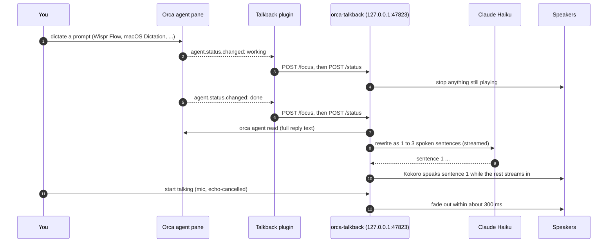

<div align="center">
  <h1>🗣️ orca-talkback</h1>
  <p><strong>Your Orca coding agents talk back. Dictate with anything, hear a short spoken summary of every finished reply, and interrupt just by talking.</strong></p>
</div>

<p align="center">
  
  
  
  
  <a href="LICENSE"></a>
</p>

---

## Table of contents

- [What is this?](#what-is-this)
- [Features](#features)
- [Quick start](#quick-start)
- [How it works](#how-it-works)
- [When it speaks](#when-it-speaks)
- [Barge-in and echo cancellation](#barge-in-and-echo-cancellation)
- [Configuration](#configuration)
- [Rewrite providers](#rewrite-providers)
- [Why Kokoro?](#why-kokoro)
- [Privacy](#privacy)
- [Troubleshooting](#troubleshooting)
- [Development](#development)
- [Roadmap](#roadmap)
- [Credits](#credits)

---

## What is this?

[Orca](https://github.com/stablyai/orca) runs a fleet of coding agents (Claude Code, Codex and friends) side by side. You can already *talk* to them with any dictation tool, such as Wispr Flow or macOS Dictation. **orca-talkback makes them talk back**, like voice mode in the Claude apps, without leaving your editor.

When an agent in the workspace you are looking at finishes a turn, orca-talkback:

1. reads the agent's full reply,
2. has Claude Haiku rewrite it as one to three sentences a colleague would actually say out loud (no code, no paths, no markdown),
3. speaks it with [Kokoro](https://huggingface.co/hexgrad/Kokoro-82M), locally, starting on the first sentence while the rest is still being written.

Start talking and it stops. Switch workspace and it stops. Send a new prompt and it stops.

This is what it sounds like, from the daemon's log after a real coding turn (lines trimmed):

```text
[status] structured-agent-session-...:cd834849 done -> speak
[say] I fixed the cutoff issue where replies were getting chopped at 200 characters.
[say] The daemon now pulls the full text from orca agent read instead, and all 73 tests are passing.
[say] When you get a chance, try talking over a long reply to check barge-in works.
[status] structured-agent-session-...:cd834849 working -> stop (agent started working)
```

| | **Claude app voice mode** | **orca-talkback** |
|---|---|---|
| **Works with** | Chats in the Claude apps | Any agent running in Orca (Claude Code, Codex, ...) |
| **Input** | Built-in mic | Whatever you already dictate with |
| **Output** | Cloud voice | Kokoro, on your Mac |
| **Interrupt** | Yes | Yes, with WebRTC echo cancellation |
| **Which agent speaks** | The one chat | Only the workspace on screen |

---

## Features

| Feature | What it means |
|---|---|
| **Focus-aware** | Only the workspace on screen speaks. Agents finishing elsewhere stay silent and are never replayed later. |
| **Spoken, not read out** | Replies are rewritten into natural speech instead of reciting code blocks and file paths. |
| **Fast start** | The first sentence is synthesised on its own while Haiku is still streaming the rest. |
| **Barge-in** | Talk over it to stop it. AEC3 removes its own voice from the mic, so it never interrupts itself. |
| **Never queues** | A newer reply replaces the current one. No backlog of stale audio. |
| **Fails quiet** | Daemon down? Orca behaves exactly as before. Model API down? It speaks a cleaned-up version of the text instead. |
| **Local audio** | Speech synthesis, voice detection and echo cancellation all run on your machine. |

---

## Quick start

**Requirements:** macOS on Apple Silicon, [Orca](https://github.com/stablyai/orca) 1.4.248 or newer, [uv](https://docs.astral.sh/uv/), and an [Anthropic API key](https://console.anthropic.com/) (or Amazon Bedrock access).

### 1. Install

```bash
brew install portaudio espeak-ng
git clone https://github.com/CallumJMac/orca-talkback.git
cd orca-talkback
uv sync
```

### 2. Add the Orca plugin

```bash
orca plugin install orca-plugin/talkback
# Orca prints a fingerprint for the access it grants (read workspace focus and agent status).
orca plugin install orca-plugin/talkback --approve <fingerprint>
```

### 3. Run the daemon

```bash
export ANTHROPIC_API_KEY=sk-ant-...      # or: ant auth login
uv run orca-talkback
```

The first run downloads the Kokoro model (about 340 MB) to `~/Library/Caches/orca-talkback`. Now ask an agent something in Orca and listen.

> **Tip:** the first time it opens the microphone, macOS asks for permission for the app that launched it (your terminal, or Orca). Barge-in needs it; playback does not.

---

## How it works



| Piece | Where | Job |
|---|---|---|
| **Talkback plugin** | `orca-plugin/talkback/` | A tiny Orca worker. Forwards focus and agent status events unchanged, in order, and re-sends focus before every status so a restarted daemon catches up. No logic. |
| **Rules** | `src/orca_talkback/rules.py` | Pure state machine: which event means speak, stop, or nothing. |
| **Reply lookup** | `src/orca_talkback/replies.py` | Reads the agent's full last message through the Orca CLI. |
| **Spoken rewrite** | `src/orca_talkback/spoken.py`, `providers.py` | Haiku rewrite, sentence streaming, plain-text fallback. |
| **Speaker** | `src/orca_talkback/speaker.py` | Kokoro synthesis in a background thread, gapless playback, fade-out, replace-not-queue. |
| **Barge-in** | `src/orca_talkback/audio.py` | WebRTC AEC3 plus Silero VAD on the cleaned mic signal. |
| **Server** | `src/orca_talkback/server.py` | Localhost HTTP: `/focus`, `/status`, `/stop`, `/health`. |

---

## When it speaks

Orca reports focus per workspace, so that is the unit. Orca also repeats `working` events throughout a turn, so only a pane's *transition* into a state counts.

| Event | Condition | Action |
|---|---|---|
| Focus changes | to a different workspace | stop playback |
| Agent finishes (`done`) | it was not already done, and its workspace is focused | speak its reply (replacing anything playing) |
| Agent finishes | in another workspace | nothing, and it is never replayed |
| Agent starts working | it was not already working, and its workspace is focused | stop playback |
| Agent blocked or waiting | any | nothing |
| You start talking | while it is playing | stop playback |

---

## Barge-in and echo cancellation

The hard part of talking over a voice is that the microphone hears the speakers too. orca-talkback borrows the tuned approach from [Trelis Research's voice-loop](https://github.com/TrelisResearch/voice-loop):

- The mic opens **only while it is speaking**, so the macOS mic indicator is off the rest of the time.
- Every sample it plays is fed to **WebRTC AEC3** as the echo reference, so its own voice is subtracted from the mic signal.
- **Silero VAD** runs on the cleaned signal. About 160 ms of continuous speech stops playback with a 30 ms fade.
- A 0.5 s inhibit at the start of each sentence and a 150 ms blanking window between sentences stop the room's reverb from being mistaken for you.

**Known limit:** your dictation tool records from its own mic without echo cancellation. If you start dictating at the exact moment you barge in, it may catch the last fraction of a second of speech. The fast fade keeps this rare.

---

## Configuration

```bash
uv run orca-talkback --help
```

| Flag | Default | What it does |
|---|---|---|
| `--provider` | `anthropic` | Who rewrites replies into speech: `anthropic`, `bedrock`, or `none` (speak cleaned-up text) |
| `--model` | `claude-haiku-4-5` | Rewrite model. On Bedrock the default is `us.anthropic.claude-haiku-4-5-20251001-v1:0` |
| `--aws-profile` | `$AWS_PROFILE` | AWS profile for `--provider bedrock` |
| `--aws-region` | `$AWS_REGION` or `us-east-1` | AWS region for `--provider bedrock` |
| `--voice` | `bf_emma` | Kokoro voice. Try `af_heart`, `af_bella`, `bm_george` |
| `--speed` | `1.1` | Speaking rate |
| `--barge-in` / `--no-barge-in` | on | Stop when you talk over it |
| `--barge-in-ms` | `160` | Continuous speech needed to interrupt. Raise it if it stops too easily |
| `--vad-threshold` | `0.8` | Speech probability threshold. Lower it if it never stops |
| `--port` | `47823` | Daemon port. The plugin expects 47823 |

---

## Rewrite providers

| Provider | Set up | Run |
|---|---|---|
| **Anthropic API** (default) | `export ANTHROPIC_API_KEY=...` or `ant auth login` | `uv run orca-talkback` |
| **Amazon Bedrock** | AWS credentials with Bedrock model access | `uv run orca-talkback --provider bedrock --aws-profile my-profile` |
| **None** | nothing | `uv run orca-talkback --provider none` |

Each rewrite is a single short Haiku call (about 200 output tokens) with a 3 s timeout and no retries. If it fails, orca-talkback speaks a cleaned-up version of the reply instead, so you always hear something.

---

## Why Kokoro?

We compared open text-to-speech models on three public leaderboards (November 2026) before picking the default:

| Model | Naturalness (UTMOS) | Error rate | Size | License |
|---|---|---|---|---|
| **[Kokoro-82M](https://huggingface.co/hexgrad/Kokoro-82M)** (default) | **4.50, best of 56** | 0.76% | 82M | Apache-2.0 |
| [Inflect-Mini-v3](https://huggingface.co/owensong/Inflect-Mini-v3) | 4.48 | 0.76% | 34M | Apache-2.0 |
| [Reverb-TTS](https://huggingface.co/software-mansion/Reverb-TTS) | 4.45 | 0.65% | 297M | CC-BY-NC |
| [pocket-tts](https://huggingface.co/kyutai/pocket-tts) | 4.33 | 0.85% | 100M | CC-BY-4.0 |
| [Chatterbox](https://huggingface.co/ResembleAI/chatterbox) | 4.40 | 1.00% | 800M | MIT |

Sources: Hugging Face's [Open TTS Leaderboard](https://huggingface.co/spaces/hf-audio/open_tts_leaderboard) (English, Seed-TTS), [VoiceHub's Seed-TTS-Eval](https://huggingface.co/datasets/kadirnar/voicehub-arena-seed-tts-eval) (Kokoro had the lowest WER of 33 models), and [TTS Arena V2](https://huggingface.co/spaces/TTS-AGI/TTS-Arena-V2) (Kokoro is the top open model with a meaningful vote count). Kokoro is the most natural, nearly the clearest, the smallest, and permissively licensed.

---

## Privacy

| Data | Where it goes |
|---|---|
| Microphone audio | Stays on your Mac. Only used for barge-in, only while speaking, never recorded. |
| Synthesised speech | Generated on your Mac. |
| The agent's reply text | Sent to the Anthropic API or Bedrock for the spoken rewrite, unless you pass `--provider none`. |
| Daemon port | Bound to `127.0.0.1` only, and it rejects non-JSON requests so web pages cannot poke it. |

---

## Troubleshooting

| Symptom | Likely cause | Fix |
|---|---|---|
| Nothing is spoken | Daemon not running, or plugin not installed | `curl -s 127.0.0.1:47823/health`; `orca plugin list` should show `talkback` as running |
| Nothing is spoken for one agent | Its workspace is not the focused one | By design. Switch to it before it finishes |
| Speech sounds like a robot reading markdown | The rewrite provider failed, so it fell back to plain text | Check the daemon log for `[spoken] rewrite failed` and your API key or AWS profile |
| Talking over it never stops it | Mic permission denied, or the threshold is too strict | Grant microphone access to the launching app; try `--vad-threshold 0.6` |
| It stops on its own | Room echo is getting through | Lower speaker volume or use headphones; try `--barge-in-ms 250` |
| `orca plugin logs` shows `daemon unreachable` | The daemon was not running when Orca sent an event | Start the daemon. The plugin re-sends focus on the next event, so no restart is needed |

---

## Development

```bash
uv sync
uv run pytest -q                                   # daemon tests (no audio hardware needed)
orca plugin test orca-plugin/talkback              # plugin tests
orca plugin validate orca-plugin/talkback
```

The design, the rules table and the trade-offs are in [`docs/design.md`](docs/design.md). Issues and pull requests are welcome.

---

## Roadmap

- **Pluggable speech engines.** Synthesis is a single `synthesize(text)` function; [pocket-tts](https://huggingface.co/kyutai/pocket-tts) (about 125 ms to first audio on CPU) is the first candidate.
- **Listing in Orca's community plugin catalog**, so the plugin installs from inside Orca.
- **Launch at login** with a launchd agent.

---

## Credits

- [Trelis Research voice-loop](https://github.com/TrelisResearch/voice-loop): the echo cancellation and barge-in approach this project ports (Apache-2.0; see [`NOTICE`](NOTICE)).
- [Kokoro](https://huggingface.co/hexgrad/Kokoro-82M) and [kokoro-onnx](https://github.com/thewh1teagle/kokoro-onnx): speech synthesis.
- [Silero VAD](https://github.com/snakers4/silero-vad): voice activity detection.
- [LiveKit](https://github.com/livekit/python-sdks): Python bindings for WebRTC AEC3.
- [Orca](https://github.com/stablyai/orca): the agent workspace this plugs into.

Licensed under the [Apache License 2.0](LICENSE). Not affiliated with Anthropic or Stably.
