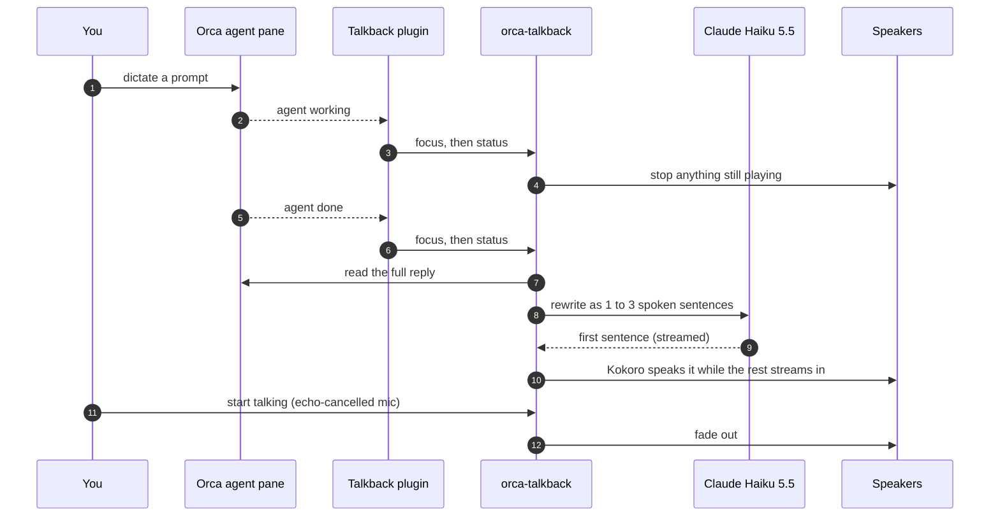

<div align="center">
  <h1>🗣️ orca-talkback</h1>
  <p><strong>Hear your Orca coding agents talk back.</strong><br>
  A one-to-three sentence spoken summary of every finished reply, voiced locally on your Mac.<br>
  Talk over it to stop it.</p>
</div>

<p align="center">
  <a href="https://github.com/CallumJMac/orca-talkback/actions/workflows/ci.yml"></a>
  
  
  <a href="https://github.com/stablyai/orca"></a>
  <a href="LICENSE"></a>
</p>

<p align="center">
  <sub><strong>Status:</strong> 0.1, early. Tested on macOS (Apple Silicon) with Orca 1.4.265 and Claude Code agents. 112 daemon tests and 14 plugin tests.</sub>
</p>

---

[Orca](https://github.com/stablyai/orca) is a desktop app that runs coding agents such as Claude Code side by side. You can already talk *to* them with any dictation tool (Wispr Flow, macOS Dictation, ...). `orca-talkback` makes them talk *back*, like voice mode in the Claude apps: when an agent in the workspace you are looking at finishes, you hear what it did and what it is asking you, in plain speech, with no code or file paths read aloud.

### What you hear after a real turn

From the daemon's log after an actual Claude Code turn (lines trimmed):

```text
[status] structured-agent-session-...:cd834849 done -> speak
[say] I fixed the cutoff issue where replies were getting chopped at 200 characters.
[say] The daemon now pulls the full text from orca agent read instead, and all 73 tests are passing.
[say] When you get a chance, try talking over a long reply to check barge-in works.
[status] structured-agent-session-...:cd834849 working -> stop (agent started working)
```

The last line is the next prompt being sent: playback stops the moment the agent starts working again.

## Contents

- [Quick start](#quick-start)
- [How it works](#how-it-works)
- [Turning it on and off](#turning-it-on-and-off)
- [Speaking or reading](#speaking-or-reading)
- [Configuration](#configuration)
- [Privacy](#privacy)
- [Troubleshooting](#troubleshooting)
- [Limitations](#limitations)
- [Why Kokoro?](#why-kokoro)
- [Development](#development)

---

## Quick start

**You need:** macOS on Apple Silicon, [Homebrew](https://brew.sh), [uv](https://docs.astral.sh/uv/), [Orca](https://github.com/stablyai/orca) 1.4.248 or newer, and an [Anthropic API key](https://console.anthropic.com/) (or [Amazon Bedrock](#configuration) access).

### 1. Install

```bash
brew install portaudio espeak-ng
git clone https://github.com/CallumJMac/orca-talkback.git
cd orca-talkback
uv sync
```

`uv sync` downloads PyTorch (for voice detection), so the first install takes a few minutes.

### 2. Add the Talkback plugin to Orca

The plugin lives in its own repo, [orca-talkback-plugin](https://github.com/CallumJMac/orca-talkback-plugin). Install it from a terminal (the `orca` CLI ships inside the app; if it is not on your PATH, use `/Applications/Orca.app/Contents/Resources/bin/orca`):

```bash
orca plugin install CallumJMac/orca-talkback-plugin
```

Orca lists the access the plugin asks for (read workspace focus and agent status) and prints a `Fingerprint: ap1-...` line. Approve exactly that:

```bash
orca plugin install CallumJMac/orca-talkback-plugin --approve ap1-<fingerprint Orca printed>
```

It is also submitted to Orca's community catalog; once listed, you can install **Talkback** from **Settings, Plugins** after adding the community marketplace (`https://github.com/stablyai/orca-community-plugins.git`, ref `main`).

### 3. Run the daemon

```bash
export ANTHROPIC_API_KEY=sk-ant-...
uv run orca-talkback
```

The first run downloads the Kokoro voice model (about 340 MB) to `~/Library/Caches/orca-talkback`. When it is ready you will see:

```text
orca-talkback listening on http://127.0.0.1:47823 (Ctrl+C to quit)
```

Check it from another terminal with `curl -s 127.0.0.1:47823/health`, then ask a Claude Code agent something in Orca and listen.

> [!NOTE]
> The first time it opens the microphone, macOS asks for permission for your terminal app. Barge-in needs it; playback works without it.

---

## How it works



1. The **Talkback plugin** is a tiny Orca worker. It forwards workspace focus and agent status to the daemon on `127.0.0.1:47823`, in order, and re-sends focus before every status so a restarted daemon catches up.
2. The **daemon** decides what to do with each event (table below). When a reply should be spoken, it reads the agent's full message through the Orca CLI and picks the quickest good spoken version: the agent's own hidden spoken line (see [Speaking or reading](#speaking-or-reading)), the reply itself if it is short and plain, or otherwise a **Claude Haiku 5.5** rewrite.
3. **Kokoro** synthesises the first sentence on its own, so you hear something while the rest is still streaming in. A newer reply replaces the current one; replies never queue up.
4. While it speaks, **barge-in** listens: every sample it plays is fed to WebRTC AEC3 as the echo reference, so only *your* voice gets through to Silero VAD. It needs about 160 ms of your voice to trigger, then fades out over 30 ms.

If the rewrite fails or times out (3 s), it speaks a cleaned-up version of the reply instead. If the daemon is not running, Orca behaves exactly as before.

### When it speaks

It only speaks while you are looking at the agent: **Orca must be the app in front**, and the agent must be **in the workspace on screen, or the chat you just sent a prompt to**. The second case exists because Orca's focus signal follows the sidebar, not chats, so sending a chat a prompt is the reliable sign you are viewing it. Orca repeats `working` events throughout a turn, so only a change of state counts.

| Event | Action |
|---|---|
| An agent you are viewing finishes, with Orca in front | Speak its reply |
| An agent finishes anywhere else, or while another app is in front | Nothing, and it is never replayed later |
| You send a prompt, or the agent on screen starts working again | Stop |
| You pick another workspace, or switch away from Orca | Stop (and the chat you prompted no longer counts as on screen) |
| You start talking | Stop |

The design document, with the full rules and trade-offs, is in [`docs/design.md`](docs/design.md).

---

## Turning it on and off

| To | Do |
|---|---|
| Mute or unmute the workspace or chat on screen | Click **🔊 Talkback** in Orca's status bar, or run **Talkback: Toggle for this workspace** from the command palette |
| Mute everything | Run **Talkback: Toggle everywhere** (the status bar reads **🔇 Talkback off**) |
| Stop the current reply | Talk over it |

Muting something that is speaking stops it at once, and your choices are remembered across restarts. Both commands can be bound to a shortcut in Orca's keyboard settings.

---

## Speaking or reading

The Talkback switch can also change how Claude Code *writes*. With the voice-mode hook installed:

| Talkback for the session | Claude Code writes | You hear | Time to first word |
|---|---|---|---|
| 🔊 On | Its normal reply, plus a hidden `<!-- spoken: ... -->` line at the end | That line, as the agent wrote it | about 0.4 s |
| 🔇 Muted | Its normal reply, for reading | Nothing | |

The spoken line is an HTML comment, so Orca hides it. No second model is involved: the agent that did the work says what it means. Without the hook, or when an agent forgets the line, short plain replies are spoken as written and only long or technical ones go to Haiku.

To install the hook, add this to `~/.claude/settings.json` (it needs `jq` and `curl`, both built into recent macOS):

```json
{
  "hooks": {
    "UserPromptSubmit": [
      { "hooks": [{ "type": "command", "command": "/path/to/orca-talkback/integrations/claude-code/talkback-voice-mode.sh", "timeout": 2 }] }
    ]
  }
}
```

On each prompt it asks the daemon whether Talkback is on for that session, and if so adds the spoken-line instruction as hidden context. If the daemon is not running, it adds nothing.

---

## Configuration

```bash
uv run orca-talkback --help
```

| Flag | Default | What it does |
|---|---|---|
| `--provider` | `anthropic` | Who rewrites replies into speech: `anthropic`, `bedrock`, or `none` (speak cleaned-up text, no API calls) |
| `--model` | `claude-haiku-5-5` | Rewrite model. On Bedrock: `us.anthropic.claude-haiku-5-5` |
| `--aws-profile` | `$AWS_PROFILE` | AWS profile for `--provider bedrock` |
| `--aws-region` | `$AWS_REGION` or `us-east-1` | AWS region for `--provider bedrock` |
| `--voice` | `bf_emma` | Kokoro voice. Try `af_heart`, `af_bella` or `bm_george` |
| `--speed` | `1.1` | Speaking rate |
| `--no-barge-in` | barge-in on | Turn off talking over it |
| `--barge-in-ms` | `160` | Continuous speech needed to interrupt. Raise it if it stops too easily |
| `--vad-threshold` | `0.8` | Speech probability threshold. Lower it if it never stops |
| `--input-device` | system input | Microphone for barge-in, matched by name, for example `"MacBook Pro Microphone"` |
| `--speak-when-hidden` | off | Also speak while another app is in front (the workspace rule still applies) |
| `--verbose` | off | Log every event the plugin forwards, with the focused workspace, for troubleshooting |
| `--port` | `47823` | Leave as is: the plugin hard-codes this port (`DAEMON_URL` in the plugin's [`src/worker.ts`](https://github.com/CallumJMac/orca-talkback-plugin/blob/main/src/worker.ts)) |

**Using Amazon Bedrock instead of an API key:**

```bash
uv run orca-talkback --provider bedrock --aws-profile my-profile
```

Each rewrite is one short call (capped at 200 output tokens) with a 3 s timeout and no retries. Set `ORCA_CLI_COMMAND` if your `orca` binary lives somewhere unusual.

---

## Privacy

| Data | Where it goes |
|---|---|
| Microphone audio | Stays on your Mac. Opened only while it is speaking, used only for barge-in, never recorded. |
| Speech | Synthesised on your Mac. |
| The agent's reply text | Sent to the Anthropic API or Bedrock for the rewrite. Use `--provider none` to keep everything local. |
| The daemon | Listens on `127.0.0.1` only and rejects non-JSON requests, which blocks simple cross-site requests from web pages. |

---

## Troubleshooting

| Symptom | Likely cause | Fix |
|---|---|---|
| Nothing is ever spoken | Daemon not running, or plugin not installed | `curl -s 127.0.0.1:47823/health`; `orca plugin list` should show `talkback` running |
| One agent never speaks | Its workspace was not on screen, or Orca was not in front, when it finished | By design. Run with `--verbose` to see every event and which workspace Orca reports as focused |
| It stops when I click another app | Replies only play while Orca is in front | By design; pass `--speak-when-hidden` to keep listening from other apps |
| It reads out markdown-ish text | The rewrite failed, so it fell back to plain text | Look for `[spoken] rewrite failed` in the daemon log; check your API key or AWS profile |
| Talking over it never stops it | The system input is a virtual device (Zoom, BlackHole), permission was denied, or the threshold is too strict | Check the `[audio] barge-in microphone:` line at startup and pass `--input-device "MacBook Pro Microphone"`; allow your terminal under System Settings, Privacy & Security, Microphone; try `--vad-threshold 0.6` |
| It stops on its own | Speaker echo is getting through | Lower the volume or use headphones; try `--barge-in-ms 250` |
| `orca plugin logs` says `daemon unreachable` | Orca sent an event while the daemon was down | Start the daemon. The plugin re-sends focus with the next event, so nothing needs restarting |

---

## Limitations

- **macOS only.** Tested on Apple Silicon. Linux may work but is untested.
- **Claude Code is the tested agent.** Other Orca agents report the same events and should work, but have not been tried.
- **Orca does not report which chat or tab is on screen.** orca-talkback infers it from the sidebar focus and from the chat you last prompted. If you prompt one chat and then just look at another without prompting it, the first one's reply still plays. In a worktree running several agents, any of them can speak; the newer reply wins.
- **Dictation overlap.** Your dictation tool records from its own microphone, without echo cancellation. If you start dictating at the exact moment you barge in, it may catch the last fraction of a second of speech.

---

## Why Kokoro?

I compared open text-to-speech models on public leaderboards (November 2026) before picking the default:

| Model | Naturalness (UTMOS) | Word error rate | Size | License |
|---|---|---|---|---|
| **[Kokoro-82M](https://huggingface.co/hexgrad/Kokoro-82M)** (default) | **4.50** | 0.76% | 82M | Apache-2.0 |
| [Inflect-Mini-v3](https://huggingface.co/owensong/Inflect-Mini-v3) | 4.48 | 0.76% | 34M | Apache-2.0 |
| [Reverb-TTS](https://huggingface.co/software-mansion/Reverb-TTS) | 4.45 | **0.65%** | 297M | CC-BY-NC-4.0 |
| [Chatterbox](https://huggingface.co/ResembleAI/chatterbox) | 4.40 | 1.00% | 800M | MIT |
| [pocket-tts](https://huggingface.co/kyutai/pocket-tts) | 4.33 | 0.85% | 100M | CC-BY-4.0 |

Kokoro scored the highest naturalness of the 56 models on Hugging Face's [Open TTS Leaderboard](https://huggingface.co/spaces/hf-audio/open_tts_leaderboard) (English, Seed-TTS), with an error rate within 0.11 points of the best, and it is small and Apache-2.0. It also had the lowest error rate of 33 models on [VoiceHub's Seed-TTS-Eval](https://huggingface.co/datasets/kadirnar/voicehub-arena-seed-tts-eval), and it is the top open model with a meaningful vote count on the human-voted [TTS Arena V2](https://huggingface.co/spaces/TTS-AGI/TTS-Arena-V2).

---

## Development

```bash
uv sync
uv run pytest -q          # daemon tests, no audio hardware needed
```

The plugin's code and tests are in [orca-talkback-plugin](https://github.com/CallumJMac/orca-talkback-plugin).

Issues and pull requests are welcome. On the roadmap:

- **More speech engines.** Synthesis is one `synthesize(text)` function; [pocket-tts](https://huggingface.co/kyutai/pocket-tts) (about 125 ms to first audio on CPU) is the first candidate.
- **Launch at login** with a launchd agent.

---

## Credits

- [Trelis Research voice-loop](https://github.com/TrelisResearch/voice-loop): the echo cancellation and barge-in approach this project ports (Apache-2.0, see [`NOTICE`](NOTICE)).
- [Kokoro](https://huggingface.co/hexgrad/Kokoro-82M) and [kokoro-onnx](https://github.com/thewh1teagle/kokoro-onnx): speech synthesis.
- [Silero VAD](https://github.com/snakers4/silero-vad): voice activity detection.
- [LiveKit Python SDK](https://github.com/livekit/python-sdks): WebRTC AEC3 bindings.
- [Orca](https://github.com/stablyai/orca): the agent workspace this plugs into.

Licensed under the [Apache License 2.0](LICENSE). Not affiliated with Anthropic or Stably.
